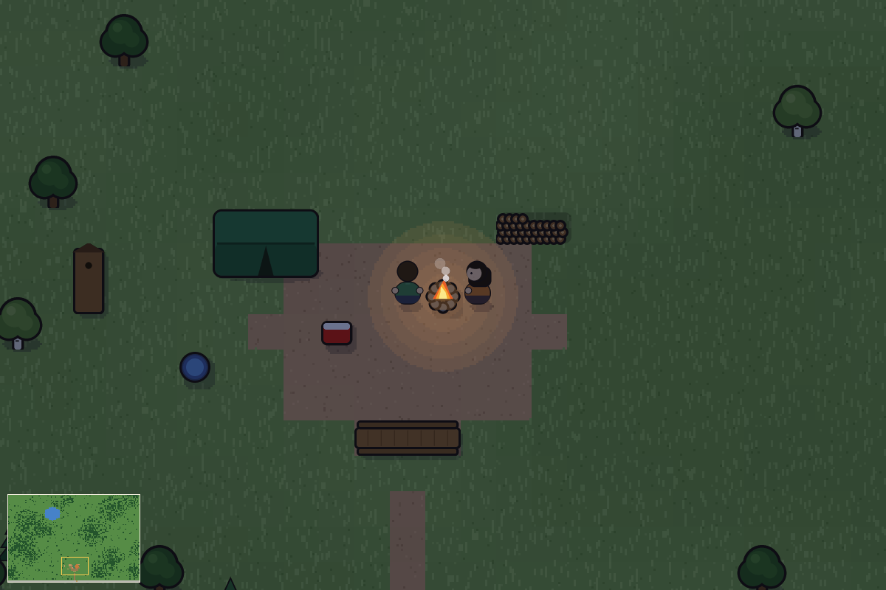
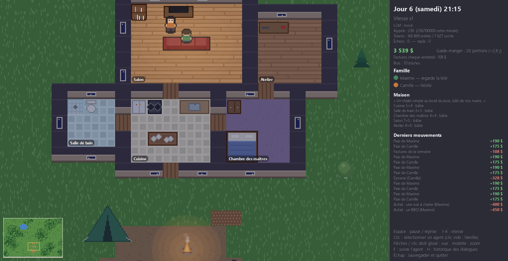
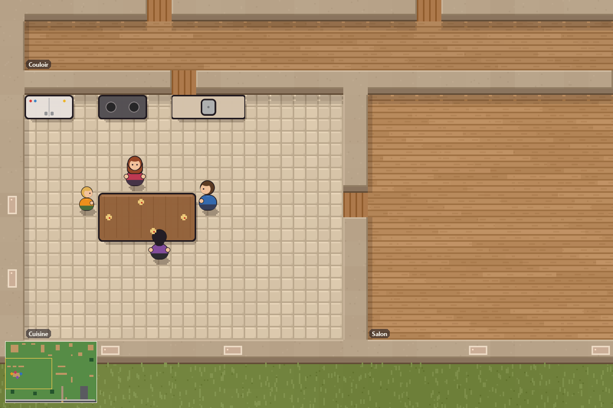
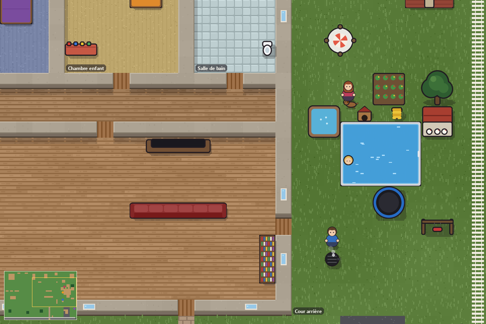
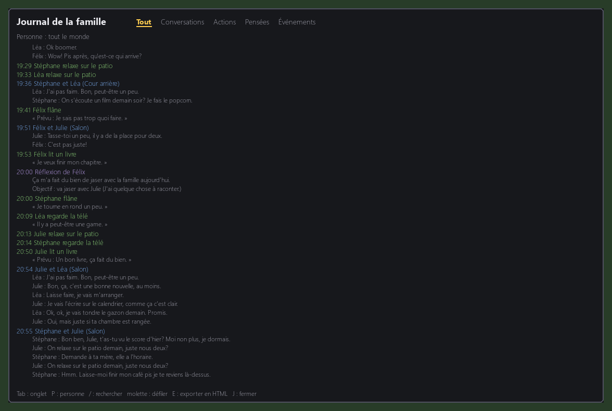

# Maison IA

Simulation 2D (vue de dessus) d'une famille québécoise de 4 personnes. Les déplacements, les besoins
et les horaires sont du code déterministe ; un LLM choisit certaines activités, écrit les dialogues
quand des membres de la famille se croisent, et résume leur mémoire. Inspiré du papier
« Generative Agents » (Stanford, 2023), en version simplifiée.



## Télécharger et jouer (Windows)

1. Va dans la page [Releases](https://github.com/IznogoudQc/maison-ia/releases) et télécharge
   `MaisonIA-Setup-x.y.z.exe`.
2. Lance l'installateur : raccourcis dans le menu Démarrer (et sur le bureau si tu veux), désinstallation
   propre.
3. Par défaut, le jeu tourne en **mode simulé** (réponses factices, gratuit, sans clé).

**Avec la vraie IA (Claude)** : il faut ta propre clé d'API Anthropic. Menu Démarrer → *Maison IA* →
*Entrer ma clé Claude* ; elle est rangée dans le Gestionnaire d'identifiants Windows, jamais dans un
fichier. Ensuite, dans *Mes sauvegardes et réglages*, ouvre `config.yaml` et mets `llm.provider: claude`.
Les sauvegardes, journaux, réglages et le catalogue d'objets modifiable sont dans `%APPDATA%\MaisonIA`.

| | |
|---|---|
|  |  |
|  |  |

**Ta clé reste à toi** : `.env` est ignoré par git, et `scripts/verifier_secrets.py` (crochet
pre-commit et GitHub Actions) bloque tout commit qui contiendrait une clé.

## Installation (depuis le code source)

Prérequis : [uv](https://docs.astral.sh/uv/) (il installe Python 3.12 au besoin).

```bash
uv sync
uv run python main.py
```

Par défaut, la simulation tourne en mode `mock` : réponses factices, sans clé API et sans coût.
Une sauvegarde `save.json` est rechargée au démarrage ; `uv run python main.py --nouveau` repart de zéro.

### Avec Claude

1. Copier `.env.example` vers `.env` et renseigner `ANTHROPIC_API_KEY` (le fichier `.env` n'est jamais commité).
2. Dans `config.yaml` : `llm.provider: claude` (modèle par défaut : `claude-haiku-5-5`).

### Avec Ollama

1. `ollama pull llama3.1:8b`, avec le serveur Ollama lancé.
2. Dans `config.yaml` : `llm.provider: ollama` (ajuster `ollama_model` et `ollama_url` au besoin).

Si le fournisseur est mal configuré (clé absente par exemple), la simulation le signale dans la
console et passe en mode mock.

## Scénarios

- **maison** (par défaut) : la famille Gagnon dans sa maison de banlieue, avec ses deux cours.
- **terrain** : un jeune couple (Maxime et Camille, `data/couple.yaml`) vient d'acheter un grand lot
  boisé (120 × 80 tuiles : forêt en massifs d'érables, de sapins et de bouleaux, un étang). Au départ :
  une tente, un feu de camp, une glacière, une table de pique-nique, un baril d'eau de pluie et une
  bécosse. Pas d'hypothèque : seulement les taxes du terrain, les cellulaires et les assurances. La
  tente repose moins bien qu'un lit et le baril lave moins bien qu'une douche (qualité des objets).
  La même graine redonne la même forêt.

**Vivre sur le terrain**
- **Couper du bois** (adultes et ados de 16 ans et plus, de 8 h à 19 h) : l'arbre le plus proche qu'on
  peut atteindre ; la forêt se coupe par la lisière. Un érable donne 6 bûches, un sapin 5, un
  bouleau 4. L'option devient pressante quand la réserve passe sous 25 bûches et disparaît à 60
  (corde pleine, visible près de la tente). La scie à chaîne (400 $) coupe deux fois plus vite.
- **Feu de camp** : un souper sur le feu brûle une bûche (sans bois : souper froid) ; le soir, on
  peut veiller autour du feu (une bûche, du plaisir et du social), et le feu éclaire la nuit.
- **Sans toit** : la tente repose moins bien, le baril lave moins bien, et vivre sans maison use le
  moral petit à petit. Les prompts savent qu'on vit encore sous la tente et combien de bois il reste.

**L'IA architecte**
- Un soir où le couple est au campement (entre 19 h et 21 h 30), un appel LLM dessine la maison :
  l'IA décide des pièces (cuisine, salle de bain, chambre, salon, bureau, atelier), de leur taille
  (dans des bornes réalistes), de leur nombre (jusqu'à 8) et de l'ordre de construction, avec une
  courte discussion du couple affichée en bulles. Elle connaît le coût estimé de chaque pièce
  (argent et bûches), leurs moyens et leurs personnalités.
- L'IA ne donne pas de coordonnées : seulement « collée à la cuisine, côté est ». Le moteur place
  chaque pièce sur la grille sans chevauchement, loin du campement et de l'étang ; une pièce
  impossible est refusée avec la raison (gardée en mémoire). Les murs, les portes entre pièces
  voisines, la porte d'entrée (côté campement), les fenêtres sur les murs extérieurs et les meubles
  selon le type de pièce sont ajoutés automatiquement ; chaque meuble reste accessible.
- Le plan apparaît au sol (piquets et corde, nom des pièces) ; les arbres sur l'emplacement portent
  un ruban rouge et deviennent prioritaires à couper (« défriche l'emplacement de la cuisine »).

**Le chantier**
- Une pièce se bâtit dans l'ordre du plan, une fois son emplacement dégagé. Au premier coup de
  marteau, on achète les matériaux (de 1 000 à 5 000 $ selon la pièce ; la cuisine et la salle de
  bain coûtent plus cher à cause de la plomberie), seulement s'il reste une semaine de dépenses en
  banque.
- Chaque séance de travail (une heure, de 8 h à 20 h) pose des bûches et avance la pièce ; il faut
  8 h + 1,2 h par case de plancher. Un charpentier ou un bricoleur (Maxime) avance 50 % plus vite.
  Sans assez de bois, on avance moins, et la coupe devient pressante (la réserve visée monte jusqu'à
  ce qu'il manque pour finir).
- Ou on engage un entrepreneur (proposé quand on en a les moyens ; l'IA décide) : 40 $ de l'heure
  de travail restante, plus les matériaux et le bois qui manque (6 $ la bûche). Son équipe vient en
  semaine, de 8 h à 16 h, et avance plus vite.
- Sur la carte : dalle de béton, charpente qui monte le long des murs, toiture vers la fin, pile de
  planches, pourcentage au-dessus ; la pancarte jaune de l'entrepreneur quand il y en a un.
- Pièce finie : murs, portes, fenêtres et meubles ; avec la chambre, le couple quitte la tente.
  On peut se promettre de bâtir (« samedi on monte les murs »).
- Pour essayer sans attendre : `world.terrain.instant_build: true` bâtit chaque pièce dès que son
  emplacement est dégagé (ni matériaux, ni travail).

**La famille grandit** (scénario terrain, section `life`)
- Le temps passe vite : un an tous les 7 jours simulés (`days_per_year`). Bébé de 0 à 2 ans, enfant
  de 3 à 12, ado de 13 à 17, adulte à 18 ; le corps grandit à 13 ans, les anniversaires des enfants
  sont fêtés (bannière, souvenirs).
- Quand le couple est heureux (moyenne des besoins et de la santé), proche (affection mutuelle),
  qu'il a un toit et un peu d'argent de côté, un soir il parle d'avoir un enfant : un appel LLM écrit
  la discussion et la décision (« pas maintenant » est une vraie réponse ; au plus une fois par
  semaine). S'il dit oui, l'architecte ajoute une chambre au plan.
- Qui porte le bébé est écrit dans la fiche (`can_be_pregnant: true`, Camille dans
  `data/couple.yaml`) ; sans fiche qui porte, le couple adopte. Grossesse de 5 jours (fatigue, plus
  de gros travaux à la fin), accouchement à l'hôpital, puis l'IA imagine le bébé : prénom, traits,
  intérêts, façon de parler qu'il aura, couleurs.
- Le bébé dort dans un berceau près du lit des parents et ne marche pas : les parents (et les ados)
  s'en occupent (biberon, couche, câlins), d'autant plus vite qu'il a faim ; un parent affamé mange
  d'abord. Le parent qui a porté le bébé (ou un des deux pour une adoption) prend un congé parental
  la première année (prestations RQAP : 70 % du salaire en semaine).
- Garderie de 1 à 4 ans (9 $ par jour), école dès 5 ans, cégep à 18 ; à 3 ans, un vrai lit libre ou
  un matelas en attendant sa chambre (l'architecte agrandit). Jusqu'à 4 enfants (`max_children`).

Pour essayer le terrain : `world.scenario: terrain` dans `config.yaml`, puis
`uv run python main.py --nouveau`. Une sauvegarde d'un scénario n'est pas rechargée dans l'autre.

## Survie de la famille

- **Argent** : compte commun. Les parents sont payés au retour du travail (`salary_per_day` dans
  `family.yaml`) ; les factures (hypothèque, Hydro, internet, assurances + frais des achats) passent
  chaque vendredi. Un solde négatif mine le moral des parents.
- **Nourriture** : chaque repas et chaque lunch prennent une portion du garde-manger. Un adulte va
  faire l'épicerie quand il baisse, dans la limite de l'argent disponible. Frigo vide : pas de repas.
- **Aliments** (`data/aliments.yaml`) : le panier change selon le budget (économique sous 400 $,
  gâteries au-dessus de 5 000 $). Chaque aliment périme (le congélateur triple la durée), on mange
  d'abord ce qui périme en premier ; le potager donne des légumes, les poules des œufs. Chacun a ses
  plats préférés (`aime:` dans le YAML de la famille) qui remontent le moral.
- **Heures supplémentaires** : proposées aux parents quand l'argent manque.
- **Calendrier québécois** (`world.date_depart`, le 15 juin 2026 par défaut) : la vraie date s'affiche dans le panneau.
  Les fériés (Jour de l'An, Vendredi saint, Patriotes, Fête nationale, fête du Canada, fête du Travail,
  Action de grâce, Noël) sont chômés et payés ; l'école ferme l'été, aux Fêtes, à la relâche, le lundi de
  Pâques et un vendredi par mois (journée pédagogique) ; les travailleurs prennent les deux semaines des
  vacances de la construction, payées. On attrape parfois la grippe (`health.sick_chance`) : on reste
  à la maison à se reposer, deux jours de maladie par année sont payés. L'IA connaît la date, les fériés
  qui s'en viennent et qui est en congé.
- **Carrière** (`data/emplois.yaml`, à enrichir) : chaque adulte a un emploi (intitulé, employeur, salaire,
  ancienneté, satisfaction au travail). Satisfait, on obtient des promotions ; au plancher, on peut être
  congédié, puis toucher l'assurance-emploi en cherchant. Des offres arrivent (sans emploi, ou quand on
  est malheureux au travail) et l'IA décide le soir de les accepter ou de retourner aux études (DEP, DEC,
  bac : frais au début, prêts et bourses pendant les cours, meilleur emploi à la fin). Les jeunes ont un
  niveau scolaire et une moyenne que les devoirs font monter ; à 18 ans, bonne moyenne : le cégep, sinon
  une première job. Tout s'affiche à droite (personne sélectionnée), dans la fiche (touche P) et dans
  le journal (touche J).
- **Revente d'occasion** : le campement se revend quand la maison le remplace (la tente quand tout le
  monde a un vrai lit, la glacière quand il y a un frigo, le baril, la bécosse, la table de pique-nique),
  et un objet du catalogue dont personne ne s'est servi depuis deux semaines rapporte 40 % de son prix.
  C'est l'IA qui décide, une revente par jour au plus.
- **Santé et mort** : faim ou épuisement à zéro font baisser la santé ; à zéro, la personne meurt
  (cadre avec ruban noir au salon, deuil des survivants). Quand toute la famille est morte, la partie
  se termine. `health.mortality: false` remplace la mort par quelques jours d'hôpital.
- **Événements aléatoires** (tirés chaque matin, au plus deux par jour) : chacun dit dans quel
  scénario il peut arriver et à quelle condition, et seuls ceux qui collent à la situation sont tirés.
  Partout : mise à pied, facture imprévue (des factures propres à chaque scénario), hausse de
  l'épicerie, prime, impôt, grand-maman (qui vient voir le bébé s'il y en a un), belle journée d'été,
  gardiennage (s'il y a un ado). Sur le terrain : orage (la tente prend l'eau, ou la bâche du
  chantier s'envole), arbre tombé (bûches gratuites), vol de matériaux et corvée entre voisins
  (pendant un chantier), ratons laveurs dans la glacière (tant qu'il n'y a pas de cuisine),
  inspecteur municipal (permis de construire, une seule fois), vente de bois de chauffage (grosse
  réserve), bébé malade (un parent rate une journée), cadeau de naissance.
- **Récit par l'IA** (`events.narrate`) : l'effet chiffré est appliqué par le moteur, puis le LLM
  raconte l'événement en une ou deux phrases avec les noms et le contexte ; le récit doit garder
  tous les chiffres, sinon (ou après 10 secondes sans réponse) le texte fixe est publié.
- **Extérieur** : le gazon pousse chaque jour. Sans tondeuse, le jeune d'à côté le tond (40 $) ;
  à 100 %, la ville donne une amende.
- **Achats** : tondeuse, BBQ, piscine, auto. Ils sont proposés aux parents seulement s'il reste deux
  semaines de dépenses en banque ; le LLM (ou le tirage déterministe) décide. L'auto fait rentrer
  du travail 30 minutes plus tôt et rend l'épicerie plus rapide et moins chère ; le BBQ remplace le
  souper la fin de semaine ; la piscine permet de se baigner.

- **Bibliothèque d'objets** (`data/catalogue.yaml`, à enrichir) : lits en gammes (matelas, lit
  simple, double, king), divans, bibliothèque, coffre à jouets, ordinateur, console, piano,
  congélateur (épicerie 8 % moins chère), potager (2 portions par jour), poulailler (1,5 portion par
  jour), trampoline, hamac, balançoire, spa, panneaux solaires (Hydro −30 $ par semaine), machine à
  espresso, laveuse-sécheuse, poêle à bois, puits, foyer extérieur, vélo stationnaire, bureau d'étude,
  lits superposés, billard, babyfoot, ping-pong, cinéma maison, aquarium, ruche (miel), cabane à
  sucre (sirop d'érable), kayak, et un **chien** : il faut le promener chaque jour, sinon il fait un
  dégât et le moral baisse. Chaque objet
  a un prix, des frais hebdomadaires éventuels, une taille, une activité (avec une qualité qui la rend
  plus ou moins efficace) et les pièces où il peut aller. Le moteur propose chaque jour quelques
  achats pertinents (un lit en priorité pour qui dort sur un matelas, une gamme supérieure, un objet
  utile) ; l'IA choisit, avec la pièce, et le moteur trouve la place exacte en gardant tout
  accessible. Un objet de gamme supérieure remplace l'ancien (revendu 40 %) ; dans le rouge, on peut
  revendre. Un achat d'objet par jour au plus (sauf un lit qui manque).

- **Véhicules** (section `vehicules` du catalogue) : vélo, moto, auto compacte, VUS familial,
  camionnette et VTT (ces deux-là sur le terrain). Prix, frais d'essence et d'assurance chaque
  semaine, places, minutes gagnées au retour du travail, capacité à rapporter l'épicerie (plus vite et
  moins cher), moral, bûches de plus par arbre (camionnette, VTT), rabais de 15 % sur les matériaux du
  chantier (camionnette). Chaque véhicule est garé près de l'entrée ; au départ, chacun prend le
  véhicule libre le plus utile pour sa course (la moto ne rapporte pas l'épicerie, le VTT ne va pas au
  travail, il faut l'âge pour conduire) et l'entrée se vide. Le moteur propose un véhicule utile (le
  premier, un VUS quand la famille ne rentre plus dans l'auto, la camionnette pendant un chantier) ;
  au plus un achat par semaine et trois véhicules. L'ancienne « auto » d'une sauvegarde devient une
  auto compacte.

- **Crédit** : quand un achat utile est trop cher comptant, le moteur propose de le financer et
  l'IA décide si la famille s'endette. Finançable : les matériaux d'une pièce (prêt rénovation,
  10 % comptant, 52 semaines, ~8 %), une première auto, un VUS quand la famille ne rentre plus dans
  l'auto, la camionnette pendant un chantier (15 % comptant, 104 semaines, ~6 %), et les objets qui
  font économiser comme les panneaux solaires (20 %, 26 semaines, ~19 %). Le prêteur refuse si les
  paiements dépassent 35 % du revenu de la semaine ou si le dossier de crédit (300 à 900) est trop
  faible ; le taux monte quand le dossier baisse. Les paiements passent le vendredi avec les
  factures (le dossier monte) ; un paiement manqué coûte 25 $ de frais, fait chuter le dossier et
  stresse les adultes ; au troisième retard sur un véhicule, la banque le reprend. Quand il y a de
  l'argent en trop, le couple peut rembourser un prêt d'un coup. Les prompts connaissent les prêts et
  le dossier ; le panneau les résume.

Les prompts du LLM reçoivent l'état du ménage (argent, garde-manger, achats, chômage, santé,
deuils, dernière nouvelle) : les dialogues en parlent naturellement.

## Vie intérieure des personnages

- **Plan du matin** : au réveil, chaque personnage demande au LLM son plan de la journée
  (3 à 6 activités placées dans ses plages libres, avec une intention). Le moteur le suit sans autre
  appel : à l'heure prévue, l'activité est choisie directement, sauf urgence (faim, fatigue,
  épicerie). Une activité impossible pendant 90 minutes est « manquée » et laisse un souvenir.
- **Nouveau plan** : une nouvelle importante (mise à pied, prime, décès, hôpital) fait refaire le
  plan du reste de la journée, au plus deux fois par jour.
- **Réflexion** (à la « Generative Agents ») : au coucher, ou plus tôt quand une journée chargée
  accumule assez d'importance, le LLM relit jusqu'à 40 souvenirs depuis la dernière réflexion. Il pose
  d'abord les grandes questions du moment, puis tire un constat par question en citant les souvenirs
  qui le prouvent ; quand assez de constats se sont accumulés, il peut en tirer une conclusion de fond
  (« Au fond : … »), plus importante et plus durable. Il désigne aussi les souvenirs marquants et peut
  fixer un objectif pour le lendemain, qui rend l'activité visée plus attirante (`mind.goal_boost`).
  Le journal (J) montre les questions, les constats et leurs preuves.
- **Mémoire pondérée** : chaque souvenir a une importance (1 à 10 ; un décès vaut 10, une
  collation 1). Les souvenirs marquants passent en mémoire longue au lieu d'être oubliés, et les
  souvenirs envoyés au LLM sont choisis selon fraîcheur + importance + lien avec la situation
  (personnes présentes, pièce, intention), par thèmes : « budget » et « paie » se reconnaissent comme
  le même sujet. Dans la fiche (P), la touche M ouvre le flux de mémoire : chaque souvenir avec son
  importance, les réflexions, et les souvenirs retenus pour la dernière demande à l'IA. Une mise à pied peut donc revenir dans une conversation
  des semaines plus tard.

Le panneau d'un personnage affiche son intention, son plan (vert = fait, rouge = manqué), son
objectif et son dernier constat ; les plans et réflexions apparaissent aussi dans l'historique (H).

## Conversations et relations

- **Tour par tour** (`dialogue.mode: tour_par_tour`, par défaut) : chaque réplique est un appel LLM
  séparé, écrit avec la mémoire, les constats et les relations de la personne qui parle seulement.
  Un personnage ne sait donc pas ce que l'autre a vécu : il peut mal comprendre, éviter un sujet ou
  cacher quelque chose. Chaque réplique comporte aussi une pensée non dite (gardée dans sa mémoire)
  et la variation de ce qu'il ressent envers la personne à qui il parle. Les bulles s'affichent au
  fur et à mesure. `mode: scene` revient à un seul appel pour toute la conversation (moins cher).
- **Bilan** : après chaque conversation, un appel relève son importance (qui fixe le poids du
  souvenir), un résumé et les promesses faites.
- **Relations** : pour chaque paire et dans chaque sens, une affection et une tension (0 à 100),
  avec la dernière impression marquante. Elles teintent tous les prompts, rendent l'envie d'aller
  jaser plus ou moins forte et espacent les conversations d'une paire en chicane. Avec le temps,
  la tension retombe et l'affection revient vers la normale.
- **Promesses** : « on joue aux Lego demain après souper » devient un rendez-vous, accepté
  seulement s'il est réaliste (activité connue, personnes libres à cette heure, piscine achetée...).
  À l'heure dite, les personnes concernées y vont d'elles-mêmes (l'horaire et les urgences passent
  avant) ; si l'activité est réservée à l'autre, on va la faire à côté en jasant. Promesse tenue :
  affection en hausse. Promesse brisée : celui qui attendait s'en souvient et la tension monte.
- **Visite** (`data/voisins.yaml`) : grand-mère, voisin, amis des enfants (maison), voisin du rang,
  sœur, chum de Maxime (terrain). Certains jours (un sur quatre en semaine, un sur deux les fins de
  semaine et fériés ; les jeunes seulement quand l'école est fermée), quelqu'un arrive par l'arrêt
  d'autobus entre 10 h et 17 h, reste une heure ou deux, jase avec la famille, puis repart. Les
  visiteurs ne font pas partie du ménage (ni achats, ni travaux, ni décision par l'IA), mais gardent
  leurs souvenirs et leurs relations d'une visite à l'autre ; on peut aussi les interroger (T).
- **Fêtes** : un mercredi ou un jeudi (ou à l'approche d'un férié), un adulte organise parfois une
  fête pour le samedi : l'IA choisit le titre, l'heure et les invités parmi les voisins et la parenté.
  Seul l'hôte le sait au départ ; l'invitation passe de bouche à oreille dans les conversations. Le
  jour venu, les invités arrivent, ceux qui n'étaient pas au courant ont la surprise, et tout le
  monde s'en souvient.
- **Rumeurs** : après une conversation, quelqu'un répète parfois un souvenir marquant sur une personne
  absente. La rumeur passe de conversation en conversation (jamais devant la personne visée) et l'IA
  la déforme à l'occasion, comme au téléphone arabe. La personne visée finit parfois par l'apprendre
  et en veut à qui l'a répandue. Tout est noté dans le journal.

Compter environ 1,5 fois plus d'appels qu'en mode scène ; à vitesse élevée, la limite
`llm.max_calls_per_minute` ralentit les conversations au lieu de dépenser plus.

## Contrôles

| Touche | Effet |
|---|---|
| Espace | pause / reprise |
| 1 à 4 | vitesse (multiplicateurs `sim.speed_multipliers`) |
| Clic sur un agent | besoins, action, humeur et mémoire dans le panneau ; clic dans le vide : vue famille |
| H | historique des dialogues (molette pour défiler) |
| J | journal complet : conversations, actions (avec la raison de l'IA), pensées (plans, réflexions, promesses), événements ; Tab : onglet, P : personne, / : rechercher, E : exporter la chronique en HTML (`chronique.html` à côté de la sauvegarde) ; gardé avec la sauvegarde |
| I | écran Maison : objets (prix, frais, effets), véhicules, garde-manger détaillé (péremption, plats préférés), prêts et dépenses de la semaine ; Tab : onglet |
| P | fiche de la personne sélectionnée : qualités et défauts, humeur et ses causes (besoins, deuil, argent, chicanes, souvenirs marquants), ce qu'elle pense de chacun (affection, tension, dernière impression) ; l'IA y met des mots à la première personne ; Tab : personne suivante |
| T | entrevue avec la personne sélectionnée : pose-lui une question, elle répond avec ses vrais souvenirs, ses constats et son caractère (une question ne laisse pas de souvenir) ; Tab : souffler une idée à la place (elle reste en tête comme un souvenir marquant, la personne revoit son plan et décide si elle y donne suite) ; noté dans le journal |
| Flèches ou WASD, clic droit glissé | déplacer la vue (grande carte) |
| Molette | zoom (dans l'historique : défiler) |
| Clic sur la mini-carte | centrer la vue à cet endroit |
| F | la caméra suit l'agent sélectionné |
| Échap | sauvegarde dans `save.json` et quitte |

## Configuration (`config.yaml`)

| Section | Clés principales |
|---|---|
| `display` | `pixel_scale` (`auto` = le plus grand agrandissement qui tient dans l'écran, ou 1, 1.5, 2, 3), `fps`, `hud_width` |
| `sim` | `tick_minutes` (minutes simulées par tick), `base_ticks_per_second`, `speed_multipliers`, `start_day` (0 = lundi), `start_time`, `seed` |
| `llm` | `provider` (`mock`, `claude`, `ollama`), `claude_model`, `claude_effort`, `max_calls_per_minute` (limite par minute réelle), `decisions_enabled`, `decision_cooldown_minutes`, `decision_max_wait_minutes`, `mock_invalid_rate` |
| `dialogue` | `mode` (`tour_par_tour` ou `scene`), `max_turns`, `max_minutes`, `pair_cooldown_minutes` (cooldown social par paire), `tense_cooldown_factor`, `tension_decay_per_day`, `promise_window_minutes`, `promise_max_days`, `max_participants`, `line_display_s` |
| `memory` | `short_term_size`, `recall_count` (souvenirs envoyés au LLM), `summary_every`, `max_summaries`, `long_term_size`, `keep_from_importance`, `recency_half_life_hours`, `max_beliefs` |
| `mind` | `plans_enabled`, `reflections_enabled`, `plan_item_window_minutes`, `max_replans_per_day`, `goal_boost` |
| `economy` | `enabled`, `start_money`, `start_pantry`, `portion_price`, `weekly_bills`, `bills_weekday`, `grocery_days`, `low_pantry_days`, `overtime_below` |
| `health` | `mortality`, `starvation_per_hour`, `exhaustion_per_hour`, `regen_per_hour`, `hospital_days`, `grief_days` |
| `events` | `enabled`, `check_time`, `frequency` (0 = jamais, 2 = deux fois plus souvent), `narrate` |
| `life` | `enabled`, `days_per_year`, `pregnancy_days`, `min_happiness`, `min_affection`, `talk_every_days`, `max_children`, `parental_leave_years`, `daycare_fee` |
| `world` | `scenario` (`maison` ou `terrain`) ; `terrain` : `width`, `height`, `seed`, `tree_density`, `family_file`, `start_money`, `start_pantry`, `weekly_bills`, `instant_build` |

Le compteur d'appels et de tokens est affiché en haut du panneau, avec le solde, le garde-manger
et les derniers mouvements d'argent. Chaque dialogue, décision LLM, départ, retour, résumé, paie,
facture, épicerie, événement et décès est écrit dans `logs/sim_<date>.jsonl`.

**Coût de la partie** : avec Claude, le panneau affiche aussi ce que la partie a coûté depuis le début (tokens × tarifs
`llm.claude_price_in` / `claude_price_out`, en $ US par million de tokens ; 0,10 $ / 0,50 $ pour Claude
Haiku 5.5). Les compteurs sont gardés dans la sauvegarde ; l'onglet Dépenses de l'écran Maison (touche I)
les reprend. En mode simulé ou avec Ollama, c'est gratuit. La facture exacte reste celle de la console Anthropic.

**Cache des prompts** : chaque demande à Claude commence par un bloc qui ne change presque pas (la fiche de la
personne, le portrait de la famille, les règles du monde). Claude le garde en cache quelques minutes et le
facture environ 10 fois moins cher aux appels suivants ; le panneau affiche les tokens relus et l'économie.

## Ajouter un persona

Ajouter une entrée sous `family:` dans `data/family.yaml` :

```yaml
  - id: grandmere            # identifiant unique, utilisé dans les relations des autres
    name: Ginette
    age: 72
    role: grand-mère
    color: [60, 160, 120]    # couleur du pion (RGB)
    traits: [taquine, généreuse]
    qualites: [généreuse, patiente]        # affichées sur la fiche (touche P), lues par l'IA
    defauts: [têtue, se mêle de tout]
    aime: [tourtiere, pouding_chomeur]       # plats préférés (data/aliments.yaml)
    interests: [le tricot, les téléromans]
    routines: [Fait sa marche tous les matins]
    relations:
      enfant: "Son petit-fils adoré, qu'elle gâte en cachette."
    speech_style: "Expressions d'antan, « mon p'tit pit »."
    bed: lit_parents         # id d'un objet « lit » de world/house.py
    favorite_actions: [lire, tele]
    salary_per_day: 0        # paie nette par journée de travail (0 = pas d'emploi)
    schedule:
      wake: "06:00"
      sleep: "21:30"
      away: null             # ou {leave: "08:00", back: "16:00", days: [0,1,2,3,4], label: travail}
      tasks:
        - {time: "18:00", action: souper}
```

- Les actions possibles (`favorite_actions`, `tasks`) sont listées dans `agents/actions.py`.
- Chaque lit a un nombre de places fixe (2 pour `lit_parents`, 1 pour les autres) : pour un
  cinquième membre, ajouter un objet `lit` dans `OBJECTS` (`world/house.py`) avec ses `use_positions`.
- La table compte 4 places : au souper, un membre de trop fait autre chose et retente de s'asseoir
  pendant 30 minutes simulées ; ajouter des `use_positions` à `table` pour l'éviter.
- Penser à ajouter la relation inverse dans les fiches des autres membres.

## Publier une version

Pousser une étiquette `vX.Y.Z` (`git tag v0.2.0` puis `git push origin v0.2.0`) : GitHub Actions lance
les tests, construit l'exécutable (PyInstaller) et l'installateur (Inno Setup, `packaging/installateur.iss`)
et l'attache à la page Releases. Après un clone : `git config core.hooksPath .githooks` active le crochet
anti-secret.

## Licence

MIT : chacun peut utiliser, modifier et redonner le jeu, en gardant la mention de licence (`LICENSE`).

## Tests

```bash
uv run pytest
```

Couverts : pathfinding A*, décroissance des besoins, parsing JSON du LLM (cas valides et invalides),
retry puis repli, limite de débit, journée simulée complète en mode mock, cooldown par paire,
sauvegarde et chargement, économie, santé, événements, extérieur, mémoire pondérée, plan et
réflexion, répliques tour par tour (point de vue de chacun), relations et promesses.

## Architecture

```
main.py              boucle pygame (tick fixe, poll LLM non bloquant, rendu)
world/               monde générique (house.py), terrain boisé (terrain.py), pièces et meubles (building.py), A*
agents/              persona, besoins, actions, horaire, mémoire pondérée, plan du jour, relations, état de l'agent
llm/                 interface + factory, Claude, Ollama, mock, prompts (décision, plan, réplique, bilan), service
sim/                 horloge, moteur, vie intérieure (mind.py), conversations (social.py), architecte (architect.py),
                     famille (family.py), économie,
                     événements aléatoires, bus, journal, config
ui/                  rendu vu de dessus, tout dessiné dans le code : sols et murs (sprites.py), personnages
                     (pawns.py), meubles et arbres (props.py), éléments animés (living.py), écrans, HUD
data/family.yaml     les personas
```

Le LLM ne gère jamais le mouvement : il choisit parmi des options calculées par le moteur, et ses
réponses sont validées (pydantic + vérification métier). Les appels tournent dans un pool de
threads ; pendant l'attente, l'agent affiche « … » et la boucle pygame continue.
